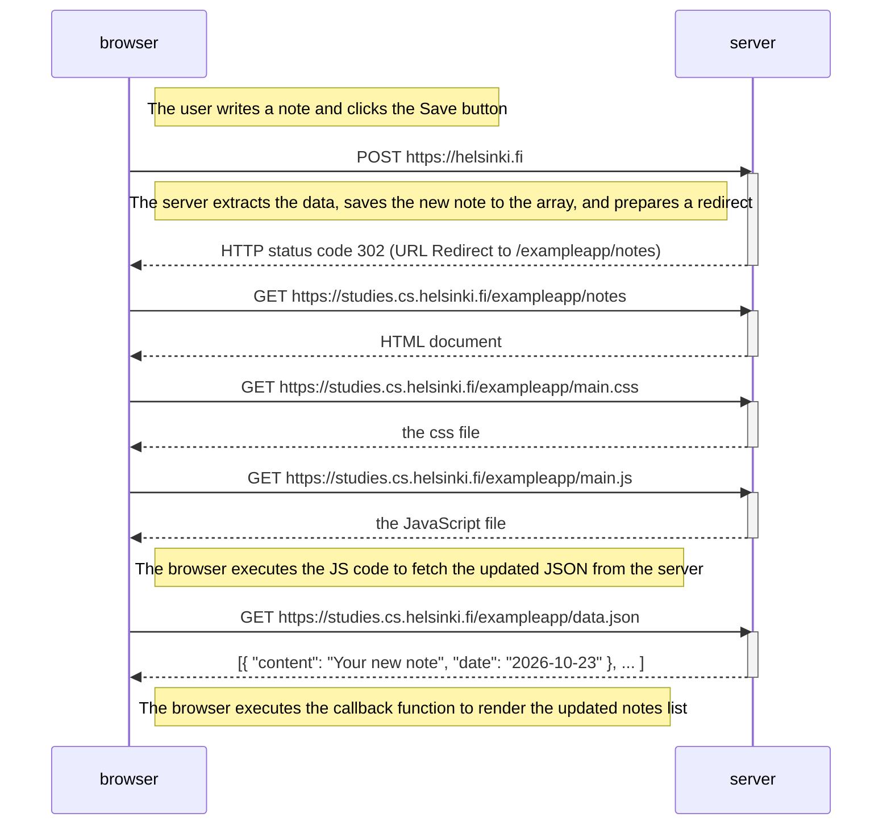
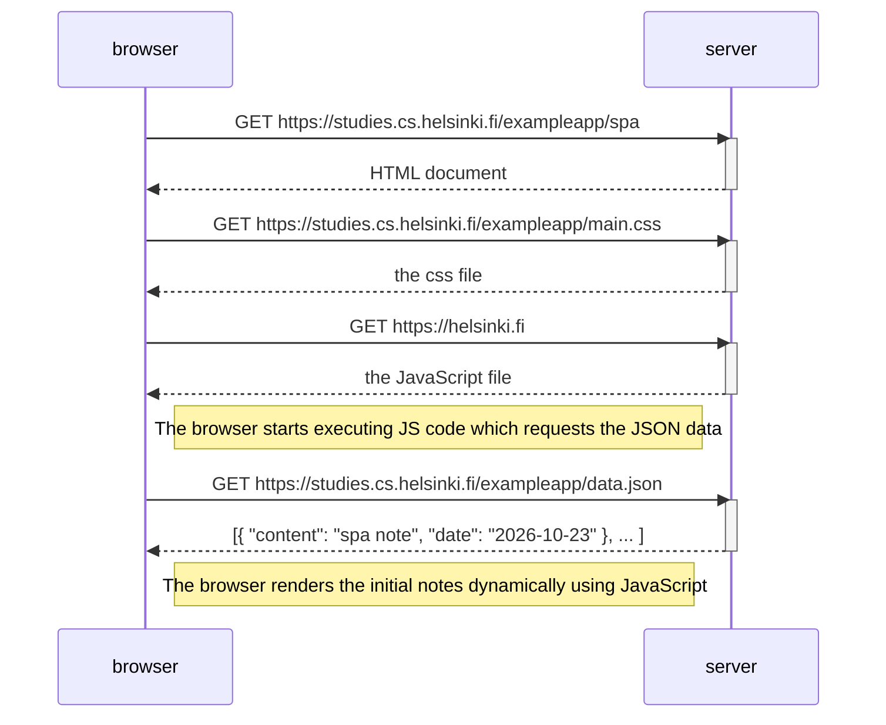

# Part 0 Exercises

## Exercise 0.4: New note diagram



## Exercise 0.5: Single page app diagram



## Exercise 0.6: New note in Single page app diagram

```mermaid
sequenceDiagram
    participant browser
    participant server

    Note right of browser: The user types a note and clicks Save

    Note right of browser: The JS code intercepts the form submit, appends the note locally, and redraws the DOM instantly

    browser->>server: POST https://helsinki.fi_spa
    activate server
    Note over browser, server: Sends JSON data: { content: "single page note", date: "2026-10-23" }
    server-->>browser: HTTP status code 201 (Created)
    deactivate server
    
    Note right of browser: No further data or page reload is requested; the UI is already updated
```
